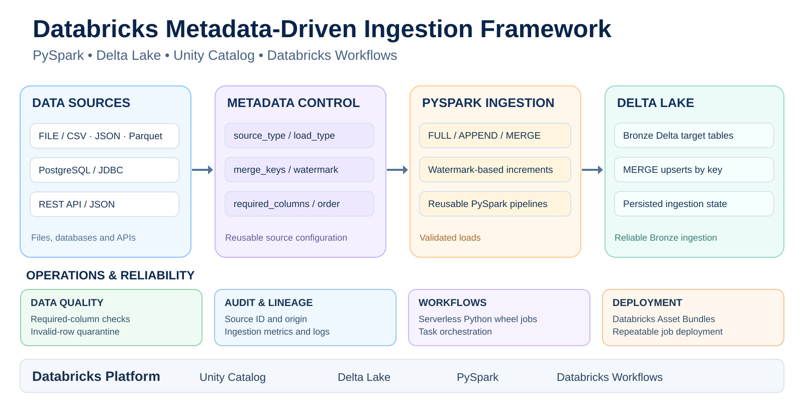

# Databricks Metadata-Driven Ingestion Framework

## Architecture




A portfolio and learning project that demonstrates a **metadata-driven ingestion framework on Databricks**.

Instead of writing one ingestion function per source, a Delta control table defines how each source is read, validated, and written. FILE, database, and REST API sources all feed the same downstream quality, load, state, audit, and quarantine pipeline.

## What it demonstrates

- FILE ingestion from Unity Catalog Volumes
- JDBC/database ingestion with Lakebase PostgreSQL
- REST API ingestion with HTTP GET + JSON
- FULL, APPEND, and MERGE strategies
- metadata-driven merge keys
- persisted watermarks
- required-column quality checks
- quarantine for invalid rows
- ingestion audit and state tables
- runtime lineage columns
- metadata enable/disable controls
- Databricks Asset Bundles
- serverless Python wheel jobs

## Why metadata-driven?

A source-specific project often grows like this:

```text
ingest_customers()
ingest_orders()
ingest_events()
ingest_accounts()
ingest_products()
```

This framework uses:

```text
make source available
        +
add/update metadata
        +
run generic ingestion
```

For a connector type the framework already supports, onboarding another compatible source usually does **not** require a new ingestion function.

## Architecture

```text
                 workspace.metadata.ingestion_sources
                              │
                    enabled configs in order
                              │
                              ▼
                       generic ingest_all()
                              │
              ┌───────────────┼───────────────┐
              ▼               ▼               ▼
            FILE             JDBC             API
       Spark file read   DB connector      HTTP GET
              └───────────────┼───────────────┘
                              ▼
                       Spark DataFrame
                              │
                   optional watermark filter
                              │
                     required-column QC
                     ┌────────┴────────┐
                     ▼                 ▼
                   valid            invalid
                     │                 │
                     │                 ▼
                     │       workspace.ops.quarantine
                     ▼
              FULL / APPEND / MERGE
                     │
                     ▼
                Bronze target
                     │
            ┌────────┴────────┐
            ▼                 ▼
 ingestion_state       ingestion_audit
```

The key separation is:

```text
source_type = HOW is the source read?
              FILE | JDBC | API

load_type   = HOW are valid rows written?
              FULL | APPEND | MERGE
```

## Proven end-to-end scenarios

| Source | Source type | Strategy | Demonstrated behavior |
|---|---|---|---|
| `customers` | FILE / CSV | FULL | Replaces the customer snapshot |
| `orders` | FILE / JSON | MERGE | Updates existing `order_id`, inserts new IDs |
| `events` | FILE / JSON | APPEND | Processes rows newer than `event_ts` watermark |
| `jdbc_accounts` | JDBC / PostgreSQL | MERGE | Filters on `updated_at`, then upserts by `account_id` |
| `api_products` | API / JSON | MERGE | Reads API JSON and upserts by `id` |

Examples demonstrated during the project:

```text
orders
5001 -> UPDATE
5005 -> INSERT
bad required-column row -> quarantine

events
watermark 10:00 -> process 11:00 and 12:00 -> watermark 12:00

jdbc_accounts
watermark 21:00
account 2 at 22:00 -> UPDATE
account 4 at 23:00 -> INSERT
new watermark -> 23:00

api_products
HTTP GET -> 5 JSON rows -> MERGE by id
```

A final all-source run also proved that **zero new incremental rows is a successful result**:

```text
events        -> 0 new rows -> SUCCESS
jdbc_accounts -> 0 new rows -> SUCCESS
```

## Metadata control table

Main table:

```text
workspace.metadata.ingestion_sources
```

| Column | Purpose |
|---|---|
| `source_id` | Logical source identifier |
| `source_type` | `FILE`, `JDBC`, or `API` |
| `enabled` | Whether the source runs |
| `source_format` | Reader/connector such as `csv`, `json`, `postgresql` |
| `source_path` | Volume path, DB host, or API URL |
| `target_*` | Bronze target |
| `load_type` | `FULL`, `APPEND`, or `MERGE` |
| `merge_keys` | Business keys used by MERGE |
| `read_options` | Reader-specific options and secret references |
| `watermark_column` | Incremental high-watermark column |
| `required_columns` | Required non-null fields |
| `ingestion_order` | Processing order |

Only enabled rows are processed:

```sql
SELECT *
FROM workspace.metadata.ingestion_sources
WHERE enabled = true
ORDER BY ingestion_order, source_id;
```

## Operational tables

```text
workspace.metadata.ingestion_state
workspace.ops.ingestion_audit
workspace.ops.quarantine
```

A useful mental model:

```text
ingestion_sources = what SHOULD happen
ingestion_state   = where incremental processing stopped
ingestion_audit   = what ACTUALLY happened
quarantine        = rejected records
```

## Load strategies

### FULL

```text
read snapshot
→ quality check
→ overwrite target
```

Used by `customers`.

### APPEND

```text
read source
→ optional watermark filter
→ quality check
→ append
```

Used by `events`. The `event_ts` watermark prevents old events from being appended again.

### MERGE

Conceptually:

```sql
MERGE INTO target
USING source
ON target.business_key = source.business_key
WHEN MATCHED THEN UPDATE SET *
WHEN NOT MATCHED THEN INSERT *
```

The match condition is built dynamically from metadata `merge_keys`.

```text
orders        -> order_id
jdbc_accounts -> account_id
api_products  -> id
```

## Watermarks

A watermark answers:

> Which source rows should be processed this run?

```text
read saved watermark
        ↓
filter watermark_column > saved watermark
        ↓
quality + write
        ↓
MAX(valid watermark_column)
        ↓
save new watermark
```

Example:

```text
saved watermark = 21:00

19:00 -> ignored
21:00 -> ignored
22:00 -> processed
23:00 -> processed

new watermark = 23:00
```

Watermark and MERGE solve different problems:

```text
watermark -> which source rows should be processed
MERGE     -> how matching/new rows should be written
```

## Source readers

### FILE

```text
source_type   = FILE
source_format = json
source_path   = /Volumes/<catalog>/<schema>/<volume>/orders
```

### JDBC / PostgreSQL

The Lakebase serverless demo uses:

```text
source_type   = JDBC
source_format = postgresql
```

Metadata supplies the database host plus options such as port, database, table, user, and password reference.

### API

The API reader supports:

```text
HTTP GET
JSON
headers
query parameters
records_path
timeout
simple page-number pagination
runtime secret references
```

## Lineage columns

Every reader adds:

```text
_source_file
_ingested_at
_source_id
```

For non-file sources, `_source_file` contains a safe logical label such as:

```text
postgresql:jdbc_accounts
api:api_products
```

## Repository layout

```text
.
├── README.md
├── databricks.yml
├── pyproject.toml
├── setup.py
├── resources/
│   └── jobs.yml
├── src/metadata_driven_ingestion/
│   ├── __init__.py
│   ├── framework.py
│   └── job.py
├── scripts/
│   ├── README.md
│   ├── lakebase_config.py
│   ├── create_lakebase_accounts.py
│   ├── create_p2_ingest_role.py
│   └── update_lakebase_accounts.py
├── sql/
│   ├── 01_inspect_metadata.sql
│   ├── 02_inspect_audit.sql
│   ├── 03_inspect_state.sql
│   ├── 04_inspect_quarantine.sql
│   ├── 05_add_new_source_template.sql
│   ├── 06_configure_lakebase_jdbc_accounts.sql
│   ├── 07_enable_jdbc_only.sql
│   ├── 08_inspect_jdbc_accounts.sql
│   ├── 09_restore_file_demo_sources.sql
│   ├── 10_configure_api_products.sql
│   ├── 11_enable_api_only.sql
│   ├── 12_inspect_api_products.sql
│   ├── 13_clean_orders_landing.sql
│   ├── 14_enable_all_sources.sql
│   └── 15_inspect_final_run.sql
└── docs/
    ├── ARCHITECTURE.md
    ├── LABS.md
    ├── INTERVIEW_CHEATSHEET.md
    └── SOURCE_TYPES.md
```

Generated folders such as `.databricks/`, `build/`, and `dist/` are not part of the clean source repo.

## Bundle jobs

```text
metadata_bootstrap
metadata_ingest
metadata_demo_update
metadata_upgrade
```

### Validate and deploy

```powershell
databricks bundle validate -t dev --profile <profile>
databricks bundle deploy -t dev --profile <profile>
```

If the CLI is not on `PATH`, use its full executable path.

### Bootstrap

**Warning:** resets Project 2 metadata/state/audit/quarantine and drops all five Project 2 Bronze demo targets.

```powershell
databricks bundle run metadata_bootstrap -t dev --profile <profile>
```

### Normal ingestion

```powershell
databricks bundle run metadata_ingest -t dev --profile <profile>
```

### FILE incremental demo

```powershell
databricks bundle run metadata_demo_update -t dev --profile <profile>
```

### Non-destructive metadata upgrade

Adds missing metadata support/templates without rewriting existing source configurations or clearing runtime state/targets.

```powershell
databricks bundle run metadata_upgrade -t dev --profile <profile>
```

## Bootstrap defaults

The clean bootstrap enables the FILE demo sources and seeds database/API rows as disabled templates:

```text
customers      -> enabled
orders         -> enabled
events         -> enabled
jdbc_accounts  -> disabled template
api_products   -> disabled template
```

After real connection settings are configured, the extended project has also been tested with **all five sources enabled together**.

## Lakebase PostgreSQL demo

Local utilities live under `scripts/` and are not deployed in the framework wheel.

Install the optional dependency:

```powershell
python -m pip install -e ".[lakebase]"
```

Typical flow:

```text
1. Create/identify a Lakebase project, branch, and endpoint.
2. Configure non-secret local settings.
3. Create public.accounts.
4. Create a read-only p2_ingest role.
5. Store credentials in Databricks Secrets.
6. Configure jdbc_accounts metadata.
7. Enable the source.
8. Run metadata_ingest.
9. Update one account and add one account.
10. Run metadata_ingest again.
11. Verify MERGE + watermark + audit/state.
```

## API demo

The repo includes the exact demonstrated configuration and inspection helpers:

```text
sql/10_configure_api_products.sql
sql/11_enable_api_only.sql
sql/12_inspect_api_products.sql
```


API behavior is metadata-controlled:

```text
URL
headers
query parameters
JSON records path
required columns
merge key
```

The learning demo also showed a realistic failure/recovery:

```text
initial request -> HTTP 403
add User-Agent + Accept headers in metadata
rerun -> SUCCESS
```

## Secrets and security

The repository intentionally keeps personal/workspace configuration out of
committed defaults. Copy `scripts/set_env.example.ps1` to
`scripts/set_env.local.ps1` for local Lakebase settings; the local file is
ignored by Git.


Do not commit passwords, tokens, or API keys.

Supported runtime references include:

```text
secret://scope/key
env://VARIABLE_NAME
```

Example:

```text
user     = secret://metadata-ingestion/db-user
password = secret://metadata-ingestion/db-password
```

For a public repository, workspace-specific hosts, user identities, CLI profiles, and secret values should also be parameterized rather than committed as personal defaults.

## Adding another compatible source

For an already-supported connector type:

```text
1. make the source reachable
2. add a metadata row
3. enable it
4. run metadata_ingest
```

The goal is to avoid adding a new source-specific Python function when the generic connector and load pipeline already support the behavior.

## Current limitations

This is a learning/portfolio framework, not a claim of production completeness.

- sources run sequentially
- API HTTP is driver-side and intended for small/moderate payloads
- API pagination is intentionally simple
- no generalized retry/backoff policy
- quality rules focus on required non-null fields
- watermark logic uses `>` and `MAX`; late-arriving/equal-timestamp rows need an explicit production policy
- schema contracts/evolution are lightweight
- generic JDBC on serverless may require Unity Catalog-managed connections
- audit tables are not yet integrated with alerting/observability tooling
- automated connector/failure-mode tests are a future improvement

## Interview summary

> I built a metadata-driven Databricks ingestion framework where a Delta control table determines the source connector, target, load strategy, merge keys, watermark, required columns, and execution order. FILE, JDBC, and REST API sources are normalized into Spark DataFrames and then share the same quality, FULL/APPEND/MERGE, audit, state, and quarantine pipeline. I demonstrated incremental APPEND with event watermarks, incremental PostgreSQL MERGE with an `updated_at` watermark, and API MERGE by business key.

Core idea:

```text
reusable connectors
+
ingestion policy in metadata
+
persisted operational state
```

## Status

Implemented and demonstrated:

```text
✓ FILE ingestion
✓ JDBC/PostgreSQL ingestion
✓ REST API ingestion
✓ FULL / APPEND / MERGE
✓ metadata-driven merge keys
✓ persisted watermarks
✓ quarantine
✓ audit history
✓ ingestion state
✓ lineage columns
✓ metadata enable/disable
✓ Databricks Asset Bundles
✓ serverless Python wheel jobs
```

Good next improvements:

```text
automated tests
retry/backoff
richer data-quality rules
schema contracts
parallel source execution
stronger API pagination
CDC patterns
observability/alerts
CI/CD
```
